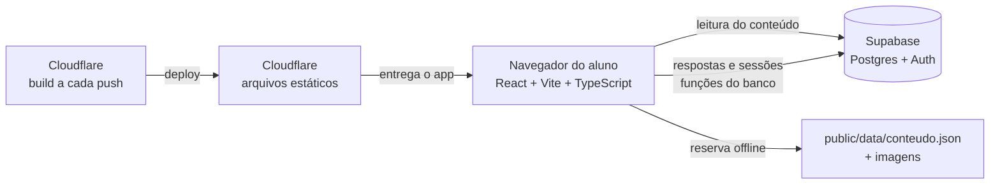
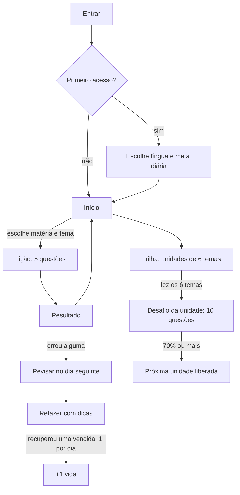
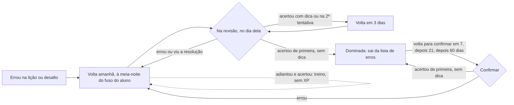

# Pense · Como o app funciona

> Documento de referência do app **Pense** (estudos para ENEM, vestibulares, concursos e seleções).
> Base: código do repositório `lmelonio/Pense`, commit `52626d7` mais o plano de melhorias de 26/10/2026 (`PENSE_MELHORIAS.md`, fases F0 a F3 e a parte de código da F4), publicado em https://lmelonio.github.io/Pense/.
> Atualizado em 26/10/2026. O mapa técnico dos módulos está em `docs/ARQUITETURA.md`.

---

## Sumário

1. [O que é o Pense](#1-o-que-é-o-pense)
2. [Arquitetura em uma página](#2-arquitetura-em-uma-página)
3. [Jornada do aluno](#3-jornada-do-aluno)
4. [Telas, uma a uma](#4-telas-uma-a-uma)
5. [Regras do jogo](#5-regras-do-jogo)
6. [O que acontece por dentro de uma lição](#6-o-que-acontece-por-dentro-de-uma-lição)
7. [Conteúdo: como uma questão é guardada e exibida](#7-conteúdo-como-uma-questão-é-guardada-e-exibida)
8. [Banco de dados (Supabase)](#8-banco-de-dados-supabase)
9. [Modo demonstração, offline e sincronização](#9-modo-demonstração-offline-e-sincronização)
10. [Segurança e privacidade](#10-segurança-e-privacidade)
11. [Configuração, publicação e comandos](#11-configuração-publicação-e-comandos)
12. [Como adicionar ou atualizar questões](#12-como-adicionar-ou-atualizar-questões)
13. [Onde mexer para mudar cada coisa](#13-onde-mexer-para-mudar-cada-coisa)
14. [Situação atual e pendências](#14-situação-atual-e-pendências)
15. [Glossário](#15-glossário)

---

## 1. O que é o Pense

O Pense é um app de **microlições**: o aluno estuda um pouco por dia, com **questões reais de provas**, uma de cada vez, e recebe retorno na hora. A lógica é a de um app de idiomas: meta diária, sequência de dias, vidas, coroas por tema e uma trilha que vai liberando conteúdo.

Os três pilares do produto:

| Pilar | Como aparece no app |
|---|---|
| **Questões reais de provas** | Cada lição traz 5 questões de provas oficiais, com o texto completo, figuras, fórmulas e o gabarito oficial. |
| **Revisão no momento certo** | Toda questão errada volta no dia seguinte na tela *Revisar*. Se o aluno acerta, ela volta em intervalos cada vez maiores (revisão espaçada). |
| **Dicas antes da resposta** | Na revisão, o aluno abre Dica 1, Dica 2 e só depois a Resolução. Cada dica reduz o XP ganho. |

**Primeiro conteúdo:** 366 questões do ENEM 2024 e 2025 (aplicação regular), organizadas em 15 matérias. O app foi desenhado para várias provas: cada questão pertence a um **exame** (ENEM, um concurso, um vestibular) e a uma **matéria** dentro dele.

---

## 2. Arquitetura em uma página



| Camada | Tecnologia | Papel |
|---|---|---|
| Interface | React 18, React Router (HashRouter), TypeScript, Vite 5 | Telas, navegação, reação imediata a cada resposta |
| Texto das questões | `marked` (Markdown), KaTeX (fórmulas), DOMPurify (limpeza de HTML) | Exibe texto, tabelas, fórmulas e figuras com segurança |
| Dados e contas | Supabase (Postgres, Auth, RLS, funções em PL/pgSQL) | Contas, progresso, pontuação oficial |
| Hospedagem | Cloudflare (Workers com arquivos estáticos, `wrangler.jsonc`), em https://pense.lucas-melonio.workers.dev/, com `npx wrangler deploy` (ou a cada push na `main`, com o GitHub ligado ao Worker). Até 25/11/2026, também no GitHub Pages (`deploy.yml`) | Site estático |
| Offline | Service worker (`public/sw.js`) + `conteudo.json` | O app abre e mostra questões sem internet |

### Pastas do código

```
src/
  screens/     telas (Entrar, PrimeiroAcesso, Inicio, Licao, Resultado, Trilha, Revisar, Refazer, Perfil, Configuracoes, NovaSenha, Pro)
  components/  ícones e mascote, barra de navegação, questão, texto e fórmulas, sem vidas, anúncio premiado, cartão do Pro
  domain/      regras.ts (regras do jogo), sessoes.ts (fechamento das sessões, as contas de concluir_sessao),
               catalogo.ts (índice por id) e os testes (regras, banco e paridade app × banco)
  data/        repo.ts (contrato da camada de dados e tradução de erros), supabaseRepo.ts (banco),
               demoRepo.ts (modo demonstração: faz o papel do servidor no navegador)
  state/       AppContext.tsx (conta, conteúdo, progresso e aviso), useSessaoEstudo.ts (ciclo de uma sessão)
  lib/         config.ts (liga o Supabase ou o modo demonstração), texto.ts (plural)
public/
  data/conteudo.json   todas as questões empacotadas (reserva offline)
  imagens/             figuras das questões
  sw.js                service worker
  termos.html, privacidade.html   Termos de uso e Política de privacidade
supabase/
  migrations/          0001 a 0010 (estrutura, regras de acesso e funções)
  seed/                01 a 16 (carga das questões em SQL)
  setup_completo.sql   soma de todas as migrations, para um banco novo
scripts/
  seed-supabase.mjs    carrega o conteúdo no Supabase
  gerar-seed-sql.mjs   gera os arquivos de seed a partir do conteudo.json
  qa/                  bateria de QA no modo demonstração (agent-browser): capturas, axe, console e rede
docs/
  ARQUITETURA.md       mapa dos módulos, seams e testes
```

### A ideia central: "mostra na hora, o servidor confirma"

A tela reage a cada resposta **na hora** (a vida some, a questão vai para a revisão) usando as regras de `src/domain/regras.ts`. Ao mesmo tempo, envia cada resposta ao banco. No fim da sessão, o banco **calcula tudo a partir das respostas registradas** e devolve o resultado oficial, que é o que fica salvo e o que a tela de Resultado mostra. No modo demonstração, o `demoRepo` faz o papel do servidor com as mesmas contas (`src/domain/sessoes.ts`).

Por isso as regras existem em dois lugares, com os mesmos valores:

- `src/domain/regras.ts` e `src/domain/sessoes.ts` (navegador);
- as funções de `supabase/migrations` (`0006`, `0007`, `0009` e `0010`), no banco.

**Ao mudar uma regra, mude nos dois**, com uma migration nova. A suíte `src/domain/paridade.test.ts` roda as mesmas sessões contra os dois lados e falha se eles divergirem.

---

## 3. Jornada do aluno



### 3.1 Formas de entrar

| Opção | O que acontece |
|---|---|
| **Continuar com Google** | Login pela conta Google. Só aparece quando o provedor Google está ligado no Supabase. |
| **Entrar com e-mail** | Entrar, criar conta ou "Esqueci minha senha" (envia um link que abre a tela *Criar nova senha*). |
| **Entrar sem login** | Cria um usuário anônimo (visitante). O progresso é gravado no banco como o de qualquer aluno. |

O **visitante** pode depois, em *Configurações*, **salvar o progresso com Google ou com e-mail**: a conta passa a ter login, e XP, sequência e coroas continuam os mesmos. Se tentar sair sem salvar, o app avisa que o progresso será apagado.

### 3.2 Primeiro acesso

Na primeira entrada o aluno escolhe só duas coisas (as duas mudam depois em *Perfil › Como você estuda*):

- **Língua estrangeira:** Inglês ou Espanhol. Define qual das duas matérias aparece e quais questões 1 a 5 do dia 1 entram nas lições.
- **Frequência de estudo (meta diária):**

| Meta | XP por dia | Tempo aproximado |
|---|---|---|
| Leve | 10 XP | 3 min |
| Regular | 20 XP | 6 min |
| Firme | 30 XP (padrão) | 10 min |
| Intensa | 50 XP | 15 min |

---

## 4. Telas, uma a uma

A barra de baixo tem quatro abas: **Início, Trilha, Revisar, Perfil**.

### 4.1 Início

- Saudação com o primeiro nome, **meta de hoje** (XP do dia / meta), **sequência** e **vidas** (com o tempo para a próxima vida e, quando vale, "ou já, acertando 1 na revisão"). Em telas estreitas, os números descem para a linha de baixo e o nome aparece inteiro.
- Cartão **Próximo passo**, na cor da matéria e com o mascote, que leva à lição com um toque. A ordem é:
  1. a **revisão do dia**, se alguma questão venceu;
  2. sem vidas e sem nada vencido, **adiantar a revisão** dos erros guardados (treino, sem XP; na primeira vez sem vidas, o cartão oferece **Revisar e recuperar 1 vida**);
  3. o **próximo tema da trilha** na matéria estudada por último, ou o **desafio da unidade**.
- Um lembrete dos **erros guardados** que ainda não venceram ("o primeiro volta amanhã"), com **Adiantar revisão**.
- **Abas por matéria** (Português, Literatura, Inglês ou Espanhol, Artes, Educação Física, Tecnologia, História, Geografia, Filosofia, Sociologia, Biologia, Química, Física, Matemática). Só aparecem matérias que têm questões na língua escolhida.
- Lista de **temas (subconteúdos)** da matéria: quantas questões tem, % de domínio, barra de progresso e coroa (Novo, Bronze, Prata, Ouro).
- Tocar num tema abre um resumo (5 questões, **até 55 XP**, vidas) e o botão **Começar**. Sem vidas, a folha mostra só as opções para recuperar vida.

No Início **qualquer tema** pode ser estudado; a ordem obrigatória existe só na Trilha.

### 4.2 Lição

- Uma questão por vez: texto de apoio, figuras, comando e as 5 alternativas.
- O aluno escolhe uma alternativa e toca em **Verificar**.
  - **Acertou:** "Mandou bem!" e o XP ganho.
  - **Errou:** "Quase lá", a letra certa e **−1 vida**. A tela rola até a alternativa certa, que fica à vista acima da explicação. A questão entra na revisão de amanhã.
  - **Primeira lição do aluno:** errar não gasta vida (o banco confere o mesmo).
  - Se a preferência *Explicação de cada questão* estiver ligada (padrão), a explicação aparece logo abaixo.
- No topo: botão de sair, barra de progresso e o contador de vidas.
- **Sem vidas no meio da lição:** o aluno pode assistir a um anúncio (+1 vida) e continuar, ou terminar ali.
- **Sair no meio:** o app pergunta e, se o aluno confirmar, salva o que já foi feito ("Sair e salvar o que fiz").

### 4.3 Resultado

Muda conforme o que aconteceu:

| Situação | O que mostra |
|---|---|
| Lição perfeita (sem erros, 3+ questões) | Tela de comemoração: "Lição perfeita!" ou "Coroa de Prata!", sequência, +5 XP de bônus |
| Lição concluída com erros | Acertos, XP, tempo, quanto falta para a meta, conquistas novas, "N questões foram para a sua Revisão" e o botão **Revisar os N erros agora** (treino até amanhã) |
| Nenhum acerto | "Não foi dessa vez" |
| Vidas acabaram | "Suas vidas acabaram"; se houver revisão vencida e a vida do dia ainda não veio, o botão principal é **Revisar e recuperar 1 vida** |
| Saiu no meio | "Lição interrompida" |
| Desafio | "Desafio vencido!" (próxima unidade liberada) ou "Quase lá!" (acerte 7 de 10) |

### 4.4 Trilha

- Cada matéria é dividida em **unidades de 6 temas**.
- Os temas aparecem como um caminho de círculos:
  - **feito** (já tem coroa), com a coroa ao lado;
  - **atual** (o primeiro ainda não feito), destacado;
  - **bloqueado** ("Conclua o tema anterior para liberar").
- O cartão da unidade diz o tema da vez ("Agora: Argumentação"); com tudo feito, "Desafio liberado" ou "Unidade concluída".
- Depois do 3º tema há um nó de **Revisão rápida**, que traz só os erros dos temas desta unidade.
- No fim da unidade há o **Desafio da unidade** (mini-simulado de 10 questões dos 6 temas). Ele libera quando os 6 temas estão feitos e o desafio da unidade anterior foi vencido.
- Vencer o desafio (70% ou mais) libera a **próxima unidade**.

### 4.5 Revisar

- Mostra quantas questões estão esperando, sem mostrar as respostas, separando os **erros** das questões **para confirmar** (as dominadas que voltaram depois de 7, 21 ou 60 dias).
- Botão principal: **Revisar agora** (as que venceram) ou, sem nada vencido, **Adiantar revisão** (os erros guardados, como treino, sem XP).
- "De onde vêm seus erros": cada bolinha é uma questão (vermelha, erro; roxa, para confirmar); tocar num tema treina só ele.
- Um tema (ou a revisão rápida da Trilha) sem nada para refazer mostra "Nada para revisar aqui" e o botão **Ver a revisão**.

### 4.6 Refazer com dicas

- Até **10 questões** por sessão (`QUESTOES_POR_REVISAO`); o resto fica para a próxima. Com mais de 10 erros na unidade, a Trilha diz "Revisar 10 dos N erros da unidade".
- Aviso: "Você errou esta questão antes. A resposta só aparece depois que você tentar." A letra marcada antes aparece como "sua resposta antes"; depois de tentar, o rótulo passa para "sua tentativa", na letra riscada (a letra e o texto ficam riscados; o rótulo, não).
- **Duas tentativas** por questão. A alternativa errada fica riscada e a tela avisa "Resta 1 tentativa".
- Questão que **ainda não venceu** (revisão adiantada) é **treino**: acertar não dá XP, não tira da lista e não devolve vida; ela volta amanhã, valendo.
- Painel de ajuda:
  - **Dica 1** → **Dica 2** → **Resolução**.
  - A Resolução só libera depois de uma tentativa errada ou das duas dicas.
  - Ver a resolução encerra a questão como não recuperada.
- XP da questão (só se ela tinha vencido): **+5** sem dica, **+4** com 1 dica, **+3** com 2 dicas. Acertar só na **2ª tentativa** conta como uma dica a mais e não domina: a questão volta em 3 dias ("Acertou na 2ª tentativa: volta em 3 dias para confirmar").
- Terminada a questão, as dicas e a resolução ficam abertas para leitura.
- No fim: "Revisão feita!" (ou "Treino feito!"), o XP ganho e **+1 vida** quando a revisão devolveu a vida do dia.

### 4.7 Perfil

- Nome, nível, XP total, sequência atual e recorde.
- **Domínio por matéria**.
- **Conquistas** (x de 8).
- **Como você estuda:** língua estrangeira, meta diária, lembrete diário, explicação de cada questão (logo após responder ou só na revisão).

### 4.8 Configurações

| Seção | Itens |
|---|---|
| Conta | Nome; forma de acesso; **Salvar com Google / com e-mail** (visitante); **Alterar senha** (conta com e-mail); modo (nuvem ou demonstração) |
| Plano | "Seu plano: Grátis" e o cartão do **Pense Pro** |
| Aparência | Tema (Claro, Noturno, Automático) e tamanho do texto |
| Sistema | Sons e efeitos, vibração, reduzir animações, **Estudar sem internet** (baixa questões e imagens para o cache) |
| Privacidade | **Política de privacidade**, **Termos de uso** e **Excluir conta** (apaga tudo, sem volta) |
| Rodapé | Sair da conta; versão do app |

### 4.9 Sem vidas e Pense Pro

Quando as vidas acabam, a tela oferece estes caminhos:

1. **Revisar e recuperar 1 vida:** quando há questões vencidas na revisão e a vida da revisão de hoje ainda não veio (acertando pelo menos 1). Se a vida de hoje já veio, o botão vira **Revisar agora**: as vencidas ainda valem XP, mas não devolvem vida. **Na primeira vez sem vidas** (o aluno nunca ganhou a vida da revisão, típico do 1º dia) e sem nada vencido, o mesmo botão adianta a revisão dos erros guardados: acertando pelo menos 1, volta 1 vida, sem XP. Uma vez só.
2. **Assistir a um anúncio:** +1 vida, até 5 por dia.
3. **Adiantar a revisão** dos erros guardados (treino, sem XP), para continuar estudando. Só aparece quando nada venceu.
4. **Esperar:** 1 vida volta a cada 2 horas.
5. **Pense Pro:** vidas ilimitadas. Ainda "em breve".

O cartão do Pro mostra os benefícios previstos e os planos em teste:

- **Benefícios previstos:** vidas ilimitadas sem anúncios, simulados completos com tempo de prova, correção de redação com IA e relatório de desempenho.
- **Mensal:** R$ 9,90.
- **Anual:** R$ 69,90.
- O botão **Me avise quando lançar** grava o interesse do aluno. Ninguém é cobrado.

> O anúncio ainda é um **espaço reservado** com contagem de 15 segundos (`src/components/AnuncioPremiado.tsx`).

---

## 5. Regras do jogo

Valores em `src/domain/regras.ts` e `src/domain/sessoes.ts` (navegador) e nas migrations `0006`, `0007`, `0008`, `0009` e `0010` (banco).

### 5.1 XP

| Ação | XP |
|---|---|
| Acerto numa lição ou desafio | **10** |
| Acerto numa questão que o aluno já tinha acertado antes | **5** |
| Bônus de lição perfeita (todas certas, mínimo 3 questões) | **+5** |
| Revisão de questão vencida: recuperou sem dica / com 1 dica / com 2 dicas | **5 / 4 / 3** |
| Revisão: acertou só na 2ª tentativa | conta como uma dica a mais (4 sem dica, 3 com dica) e não domina (volta em 3 dias) |
| Revisão adiantada (questão que ainda não venceu) | 0 (é treino) |
| Erro, ou viu a resolução | 0 |

### 5.2 Níveis

O nível vem do XP total:

| Nível | XP mínimo | Nome |
|---|---|---|
| 1 | 0 | Iniciante |
| 2 | 50 | Aprendiz |
| 3 | 150 | Atenta |
| 4 | 300 | Persistente |
| 5 | 500 | Focada |
| 6 | 750 | Estudiosa |
| 7 | 1.050 | Curiosa |
| 8 | 1.500 | Exploradora |
| 9 | 2.000 | Determinada |
| 10 | 2.600 | Brilhante |
| 11 | 3.300 | Mestre |
| 12 | 4.100 | Sábia |
| 13 a 17 | 5.000 / 6.000 / 7.200 / 8.500 / 10.000 | Lenda |

### 5.3 Meta diária e sequência

- O XP é somado por dia (no fuso do aluno; se o fuso vier inválido, vale o de Brasília).
- Quando o XP do dia **passa da meta**, a sequência sobe 1, se a meta também foi batida ontem; senão, recomeça em 1.
- Se passa um dia inteiro sem bater a meta, a sequência mostrada volta a 0. O recorde fica guardado.

### 5.4 Vidas

| Regra | Valor |
|---|---|
| Máximo | **3 vidas** |
| Errar numa **lição** | −1 vida (no desafio e na revisão não gasta) |
| **Primeira lição** do aluno | Não gasta vida. Vale até ele responder a primeira questão: sair no meio sem concluir não deixa a próxima grátis |
| Recarga automática | +1 a cada **2 horas**, até 3 |
| Anúncio assistido | +1 vida, até **5 em 24 horas** |
| Revisão que recupera pelo menos 1 questão **vencida** | +1 vida, **1 por dia** (no fuso do aluno), só quando falta vida; revisão adiantada não devolve vida |
| **Primeira vez sem vidas** (nunca ganhou a vida da revisão) | A revisão adiantada (treino) também devolve 1 vida, acertando pelo menos 1, sem XP. **Uma vez só**; depois, vale a linha de cima |
| Com 0 vidas | O banco recusa novas respostas em lição (`sem_vidas`) |

### 5.5 Domínio e coroas por tema

- **Domínio** = % de acertos nas **últimas 10 respostas** daquele tema.
- **Coroa** (nunca desce):

| Coroa | Condição |
|---|---|
| Novo | Nenhuma lição com acerto |
| **Bronze** | Pelo menos 1 acerto no tema |
| **Prata** | Domínio ≥ 60% com 5+ respostas |
| **Ouro** | Domínio ≥ 85% com 8+ respostas |

- **Lição perfeita** no tema sobe uma coroa direto (ex.: Bronze → Prata), até o Ouro.

### 5.6 Revisão espaçada



- Só a revisão **no dia da questão** conta: dá XP, pode dominar e pode devolver a vida do dia.
- Revisar **antes do dia** (Adiantar revisão) é treino: acertando, a questão continua na lista e volta amanhã. A única vida que o treino devolve é a da primeira vez sem vidas (seção 5.4).
- A questão **dominada** volta para confirmar quando vence (7, 21 e 60 dias); errando, volta a ser um erro pendente.

Cada item da fila guarda:

- a data em que vence;
- quantas vezes foi recuperado (repetições);
- quantas vezes foi errado de novo (lapsos);
- a última letra marcada (mostrada como "sua resposta antes").

### 5.7 Lições, trilha e desafio

| Constante | Valor | O que controla |
|---|---|---|
| `QUESTOES_POR_LICAO` | 5 | Questões por lição |
| `TEMAS_POR_UNIDADE` | 6 | Temas em cada unidade da trilha |
| `DESAFIO_QTD` | 10 | Questões do desafio da unidade |
| `DESAFIO_MINIMO` | 0,7 | Acerto mínimo para vencer o desafio (7 de 10) |

**Como a lição é montada:**

1. Pega as questões do tema escolhido.
2. Coloca primeiro as **nunca vistas**, em ordem aleatória, e depois as já vistas.
3. Se o tema tem menos de 5 questões, completa com outros temas da mesma matéria.
4. As questões de língua estrangeira só entram se forem da língua escolhida.

**Ordem dos temas:** do tema com mais questões para o com menos; em caso de empate, ordem alfabética. É essa ordem que forma as unidades da Trilha (temas 1–6 = unidade 1, 7–12 = unidade 2…).

> **Atenção:** como a ordem depende da quantidade de questões, **adicionar questões pode reordenar os temas** e mudar a composição das unidades. Veja a seção 12.

### 5.8 Conquistas

| Código | Nome | Condição |
|---|---|---|
| `primeiro_passo` | Primeiro passo | Concluiu a primeira lição |
| `sete_dias` | 7 dias seguidos | Sequência recorde ≥ 7 |
| `licao_perfeita` | Lição perfeita | Terminou uma lição sem errar |
| `revisao_em_dia` | Revisão em dia | Concluiu 5 revisões |
| `trezentas` | 300 questões | Respondeu 300 questões |
| `dez_ouros` | 10 coroas de Ouro | 10 temas no Ouro |
| `quatro_areas` | Todas as áreas | Praticou todas as áreas do exame (no ENEM: Linguagens, Humanas, Natureza e Matemática) |
| `trinta_dias` | 30 dias seguidos | Sequência recorde ≥ 30 |

---

## 6. O que acontece por dentro de uma lição

```mermaid
sequenceDiagram
  participant T as Tela (navegador)
  participant B as Banco (funções)
  T->>B: iniciar_sessao(tipo, exame, matéria, tema, unidade, fuso)
  B-->>T: id da sessão
  loop cada questão
    T->>T: aluno escolhe e toca em Verificar; a tela mostra certo/errado na hora
    T->>B: responder(sessão, questão, letra, dicas, viu_resolução, tempo)
    B->>B: confere o gabarito, gasta a vida (lição), agenda a revisão (erro)
  end
  T->>B: concluir_sessao(sessão)
  B->>B: calcula XP, bônus, domínio, coroas, unidade, XP do dia, sequência e conquistas
  B-->>T: resumo oficial
  T->>T: tela de Resultado com o resumo do banco; relê os dados do aluno
```

**Proteções embutidas:**

| Proteção | Como funciona |
|---|---|
| Clique repetido em *Verificar* | Vale **uma resposta por questão** em cada lição ou desafio. Uma repetida devolve a mesma resposta, sem efeito. |
| Clique repetido em *Ver resultado* | Concluir a sessão de novo devolve **o mesmo resumo**, sem somar outra vez. |
| Respostas que falharam no envio | São **reenviadas no fim**, e o banco ignora as repetidas. |
| Limite da revisão | Até 2 tentativas por questão, até 10 questões por sessão, só questões da fila do aluno. |
| Pontuação pela API | O aluno **não consegue gravar XP, vidas, coroas ou conquistas** direto: a API devolve `permission denied`. |

---

## 7. Conteúdo: como uma questão é guardada e exibida

### 7.1 Hierarquia

```
Exame (ex.: enem)
 └─ Matéria / recorte (ex.: enem-GEO · Geografia · área Humanas)
     └─ Assunto / tema (ex.: Urbanização)
         └─ Tópico (ex.: "Agricultura urbana")
             └─ Questão
```

| Termo no código | Termo no app | Exemplo |
|---|---|---|
| `exames` | Prova | `enem` |
| `recortes` | Matéria | `enem-MAT` (Matemática, área Matemática) |
| `assunto` | Tema / subconteúdo | Estatística |
| `topico` | (detalhe, não aparece como tela) | Média aritmética |

As 15 matérias do ENEM e a área de cada uma:

| Área | Matérias |
|---|---|
| Linguagens | POR, LIT, ING, ESP, ART, EDF, TIC |
| Humanas | HIS, GEO, FIL, SOC |
| Natureza | BIO, QUI, FIS |
| Matemática | MAT |

### 7.2 Campos de uma questão

| Campo | Descrição |
|---|---|
| `id` | `{ano}-D{dia}-Q{número}` (ex.: `2024-D2-Q137`). Questões 1–5 do dia 1 têm sufixo `-ING` ou `-ESP`. |
| `exame_id`, `recorte_id` | Prova e matéria |
| `banca`, `orgao`, `cargo` | Para concursos (no ENEM ficam vazios ou com INEP) |
| `ano`, `numero` | Ano e número na prova |
| `formato` | `5_alternativas` (também previstos `4_alternativas` e `certo_errado`) |
| `disciplina`, `assunto`, `topico` | Classificação |
| `lingua` | Inglês, Espanhol ou vazio. Filtra pela língua do aluno. |
| `texto_base_id` | Texto compartilhado por várias questões (opcional) |
| `texto_apoio` | Enunciado em **Markdown + LaTeX** |
| `comando` | A pergunta final |
| `figuras` | Lista de `{imagem, descricao}`. A descrição serve para acessibilidade. |
| `alternativas` | `{letra, texto, imagem}`; a alternativa pode ser uma imagem |
| `gabarito` | Letra certa (gabarito oficial) |
| `dica1`, `dica2`, `explicacao` | Ajuda progressiva e resolução |
| `dificuldade` | fácil, média ou difícil |

### 7.3 Como o texto é exibido (`src/components/Texto.tsx`)

| Recurso | Como escrever | Exemplo |
|---|---|---|
| Itálico, negrito, parágrafos, tabelas | Markdown | `*itálico*`, `**negrito**`, `\| a \| b \|` |
| Fórmulas | LaTeX entre `$...$`, renderizado pelo KaTeX | `$\frac{3}{4}$`, `$\text{H}_2\text{O}$` |
| Dinheiro | `R\$` (com barra), para não virar fórmula | `R\$ 10,00` |
| Figura no meio do texto | `{{figura:N}}` | `{{figura:1}}` |
| Fonte do texto | Parágrafo começando com `Fonte:` (ganha estilo de citação) | `Fonte: AUTOR. **Livro**...` |

Figuras não posicionadas no texto aparecem no fim. Todo o HTML passa pelo **DOMPurify**: scripts, eventos e links `javascript:` são removidos.

### 7.4 De onde o app lê o conteúdo

1. **Com Supabase:** carrega `exames`, `recortes`, `textos_base` e `questoes` (com alternativas e figuras), só as **ativas** (`ativa = true`). A carga é feita em páginas.
2. **Reserva:** se o banco demorar ou falhar, usa `public/data/conteudo.json`, que vai junto com o app.
3. **Imagens:** ficam em `public/imagens/<ano>/<D1|D2>/q###_figN.webp` (alternativas em imagem: `q###_alt_X.webp`).

---

## 8. Banco de dados (Supabase)

### 8.1 Tabelas

| Grupo | Tabela | Para que serve |
|---|---|---|
| **Conteúdo** (leitura pública) | `exames` | Provas (ENEM, concursos…), com `ativo` |
| | `editais`, `edital_conteudo` | Editais de concursos e o conteúdo cobrado (para a fase de concursos) |
| | `recortes` | Matérias de cada exame, com `ordem`, `cor` e `area` |
| | `textos_base` | Textos compartilhados entre questões |
| | `questoes` | Questões (com `ativa`) |
| | `alternativas` | Alternativas de cada questão |
| | `questao_figuras` | Figuras de cada questão, em ordem |
| | `conquistas` | Catálogo de conquistas |
| **Aluno** (cada um só vê o seu) | `perfis` | Nome, XP total, vidas, sequência, contadores |
| | `preferencias` | Exame, língua, meta, lembrete, tema, tamanho do texto, sons etc. |
| | `xp_diario` | XP por dia |
| | `sessoes_estudo` | Cada lição, desafio ou revisão (início, fim, resumo) |
| | `tentativas` | Cada resposta dada |
| | `progresso_tema` | Domínio, coroa, lições e histórico por tema |
| | `fila_revisao` | Questões erradas e quando voltam |
| | `progresso_unidade` | Desafios vencidos (`matéria\|unidade`) |
| | `usuario_conquistas` | Conquistas obtidas |
| | `interesse_pro` | Plano em que o aluno pediu aviso |
| | `assinaturas` | Reservada para o Pro (só leitura pelo aluno) |
| | `vidas_ganhas` | Registro de vidas por anúncio e revisão, para o limite diário (sem acesso direto) |

### 8.2 Funções chamadas pelo app

| Função | O que faz |
|---|---|
| `garantir_perfil()` | Cria perfil e preferências se faltarem (contas antigas) |
| `iniciar_sessao(...)` | Abre uma lição, desafio ou revisão e devolve o id; confere a lista de questões; marca a primeira lição (sem custo de vida: nenhuma questão feita e nenhuma tentativa) |
| `responder(...)` | Confere o gabarito, gasta vida (lição), agenda a revisão (erro), evita duplicatas |
| `abrir_dica(...)` | Registra a dica aberta na revisão (o XP da questão usa este registro) |
| `concluir_sessao(sessão)` | Calcula e grava XP, bônus, domínio, coroas, unidade, revisão, vida do dia, XP do dia, sequência e conquistas; devolve o resumo |
| `ganhar_vida_anuncio()` | +1 vida, até 5 por dia (`limite_anuncios`) |
| `excluir_minha_conta()` | Apaga a conta e todos os dados (LGPD) |

**Outras peças:**

- **Gatilho de cadastro:** cria o perfil e as preferências quando surge um usuário novo, inclusive Google e visitante. O nome tem até 40 caracteres e o padrão é "Estudante".
- **Visões:** `v_resumo_conteudo` (questões por matéria) e `v_ranking_semana`. O ranking ainda não aparece no app.

### 8.3 Migrations

| Arquivo | Conteúdo |
|---|---|
| `0001_conteudo.sql` | Tabelas de conteúdo e leitura pública |
| `0002_aluno.sql` | Tabelas do aluno e regras de acesso "dono" |
| `0003_funcoes.sql` | Gatilho de novo usuário, `excluir_minha_conta` |
| `0004_dados_base.sql` | Exame ENEM e conquistas |
| `0005_materias_e_vidas.sql` | 15 matérias no lugar das 4 áreas; vidas limitadas a 3 |
| `0006_pontuacao_no_servidor.sql` | Pontuação no banco, permissões restritas, `vidas_ganhas` |
| `0007_sessoes_conferidas.sql` | O banco confere as questões de cada sessão, a revisão e a ordem do desafio; `abrir_dica` |
| `0008_recarga_2h.sql` | Recarga de 1 vida a cada 2 horas |
| `0009_regras_revisao.sql` | Revisão adiantada é treino; vida da revisão 1 por dia; dominada volta para confirmar; primeira lição sem gastar vida; 2ª tentativa conta como dica |
| `0010_revisao_ajustes.sql` | Primeira lição grátis só até a primeira resposta; 2ª tentativa não domina (volta em 3 dias); na primeira vez sem vidas, o treino devolve 1 vida |

Banco novo: rode `supabase/setup_completo.sql`. Banco existente: rode só as migrations que faltam.

---

## 9. Modo demonstração, offline e sincronização

### 9.1 Modo demonstração

Sem `VITE_SUPABASE_URL` e `VITE_SUPABASE_ANON_KEY`:

- o app roda inteiro no navegador (`demoRepo.ts`);
- o progresso fica salvo **só naquele navegador**;
- uma faixa avisa: "Modo demonstração".

Nesse modo, o `demoRepo` faz o papel do servidor: confere o gabarito, gasta as vidas, agenda a revisão e fecha as sessões com as mesmas contas do banco (`src/domain/sessoes.ts`). Para testar sem tocar no Supabase de produção: `VITE_SUPABASE_URL= VITE_SUPABASE_ANON_KEY= npm run dev`.

### 9.2 Offline

- O service worker usa **rede primeiro**. Se a rede falhar, usa o que está no cache: o app, `conteudo.json`, o ícone e as imagens já abertas. Os arquivos de `assets/` (com hash no nome) vêm do cache primeiro, e só a navegação recebe o `index.html` de reserva.
- Depois de uma publicação nova, uma aba antiga que pede um pedaço do app que já não existe recarrega sozinha uma vez; se ainda falhar, aparece **Esta tela não abriu** com o botão **Atualizar o app**, em vez da tela em branco.
- Em *Configurações › Estudar sem internet*, o aluno baixa todas as questões e imagens para o cache.
- **Sem internet**, as questões aparecem, mas as respostas não chegam ao banco. O app avisa que não conseguiu salvar.

### 9.3 Sincronização

`AppContext` cuida da sincronização:

- carrega os dados do aluno uma vez por login;
- mostra as mudanças na hora e grava em seguida;
- se a gravação falhar, avisa e **relê do servidor**, para a tela não mostrar algo que não foi salvo;
- toda chamada ao servidor tem **limite de 10 s**, para o app não ficar preso em "Carregando…".

Erros do Supabase (que vêm em inglês) são traduzidos para mensagens em português em `src/data/repo.ts`.

---

## 10. Segurança e privacidade

| Ponto | Situação |
|---|---|
| **RLS (Row Level Security)** | Conteúdo: leitura pública. Dados do aluno: só o dono lê. |
| **Escrita restrita** | O aluno grava direto apenas **nome, preferências e interesse no Pro**. O resto passa pelas funções do banco. |
| **Chaves** | A chave *publishable/anon* pode ficar no app publicado (protegida pelo RLS). A *secret/service_role* **nunca** vai para o GitHub; serve só para carregar questões pelo terminal. |
| **Login** | Fluxo PKCE; sessão renovada automaticamente. |
| **HTML das questões** | Limpo pelo DOMPurify antes de exibir. |
| **CSP** | Política de segurança de conteúdo numa `<meta>` do build. O build também gera `_headers` (Cloudflare Pages e Netlify) com a mesma política, `frame-ancestors 'none'`, `X-Content-Type-Options` e `Referrer-Policy`; o GitHub Pages ignora esse arquivo. |
| **CAPTCHA** | Cloudflare Turnstile pronto no app: aparece com `VITE_TURNSTILE_SITE_KEY` (e o CAPTCHA ligado no Supabase). Sem a chave, nada é carregado do Cloudflare. |
| **Fontes** | Servidas pelo próprio app (`@fontsource`), sem chamada ao Google Fonts. |
| **Exclusão de conta** | `excluir_minha_conta()` apaga tudo (LGPD). |
| **Termos e privacidade** | `public/termos.html` e `public/privacidade.html`, ligados na entrada e nas Configurações; funcionam sem internet. Falta preencher o responsável e o e-mail de contato. |
| **ECA Digital** | Parte do público é menor de idade: sem publicidade por perfil, sem caixas de recompensa, padrão mais protetivo. |

---

## 11. Configuração, publicação e comandos

### 11.1 Variáveis (`.env`, nunca no GitHub)

| Variável | Valor |
|---|---|
| `VITE_SUPABASE_URL` | `https://<id-do-projeto>.supabase.co` |
| `VITE_SUPABASE_ANON_KEY` | Chave *publishable* (`sb_publishable_…`) |
| `SUPABASE_SERVICE_ROLE_KEY` | Chave *secret* (`sb_secret_…`), só para `npm run seed` |

### 11.2 Supabase (Authentication)

- **Sign In / Providers:**
  - *Allow anonymous sign-ins* ligado (Entrar sem login);
  - *Email* ligado;
  - *Allow manual linking* ligado (visitante salvar com Google);
  - Google, quando houver cliente OAuth.
- **URL Configuration:**
  - Site URL: `https://pense.lucas-melonio.workers.dev/`;
  - Redirect URLs: `http://localhost:5173/**`, `https://pense.lucas-melonio.workers.dev/**` e, até 25/11/2026, `https://lmelonio.github.io/Pense/**`.
- **E-mails:** o envio padrão só entrega para a equipe do projeto. Para "Esqueci minha senha" funcionar para todos, configure um SMTP próprio (Resend, Brevo, SES…).

### 11.3 Publicação (Cloudflare; GitHub Pages até 25/11/2026)

- **Cloudflare:** o `wrangler.jsonc` publica a pasta `dist` (sem `main` e sem `not_found_handling`, porque as rotas usam `#`). Build `npm run build`, deploy `npx wrangler deploy`; `VITE_SUPABASE_URL`, `VITE_SUPABASE_ANON_KEY` e `VITE_TURNSTILE_SITE_KEY` nas variáveis do build. Passo a passo na seção 5 do README.
- **GitHub Pages:** *Settings › Pages › Source* = **GitHub Actions**; `VITE_SUPABASE_URL` e `VITE_SUPABASE_ANON_KEY` em *Settings › Secrets and variables › Actions*; cada push na `main` dispara o `.github/workflows/deploy.yml`. **Desligar em 25/11/2026** (lembrete com os passos no README).

### 11.4 Comandos

| Comando | O que faz |
|---|---|
| `npm install` | Instala as dependências |
| `npm run dev` | Roda local em `http://localhost:5173` |
| `npm run build` | Gera a pasta `dist` |
| `npm run preview` | Testa o build |
| `npm run typecheck` | Confere os tipos (app e testes) |
| `npm test` | Regras, banco (PGlite) e paridade app × banco; antes, uma vez: `npm install --no-save @electric-sql/pglite@0.2.17` |
| `bash scripts/qa/subir_demo.sh . 5173` e `bash scripts/qa/jornada.sh http://127.0.0.1:5173/ qa-saida` | Bateria de QA no modo demonstração (19 capturas, axe, console e rede) |
| `npm run seed` | Carrega as questões no Supabase (precisa da chave secret) |
| `npm run gerar-sql` | Regera `supabase/seed/*.sql` a partir do `conteudo.json` |

Para conferir o conteúdo no banco:

```sql
select * from v_resumo_conteudo;
```

---

## 12. Como adicionar ou atualizar questões

### 12.1 Hoje (manual)

1. Editar `public/data/conteudo.json` e colocar as imagens em `public/imagens/`.
2. Rodar `npm run seed` (ou `npm run gerar-sql` e os arquivos de `supabase/seed/` no SQL Editor).
3. Fazer push, para o app publicado levar o novo `conteudo.json` e as imagens.

### 12.2 Processo novo, em construção (atualização por arquivo)

Combinado: **um ano por vez**, começando pelo ENEM 2023, com **um comando no seu computador**.

| Etapa | Situação |
|---|---|
| Extração das provas e gabaritos (PDF do INEP) para revisão | Feita para 2023 (185 questões; a Q177 do dia 2 foi anulada) |
| Transcrição com classificação, dicas e explicação | **130 de 184** transcritas. As 94 dos lotes 01 a 06 e do piloto já foram conferidas. Os lotes 07 a 12 pararam no limite de uso: as questões que eles deixaram prontas ainda serão conferidas, e o restante será retomado. |
| Imagens finais (webp) e arquivo de atualização `atualizacoes/2026-10-enem-2023.json` | A fazer |
| Planilha de conferência para sua revisão | A fazer |
| Migration nova (depois da `0010`): tabela `temas` com **ordem fixa** | A fazer, antes de importar |
| Script `npm run importar <arquivo>` | A fazer |

Por que essa migration vem antes: hoje a ordem dos temas depende da quantidade de questões (seção 5.7). Sem ordem fixa, a importação reordenaria as unidades da Trilha dos alunos.

**Como o importador vai funcionar:**

1. Valida o arquivo: campos, gabarito, matéria, imagens existentes.
2. Mostra uma prévia (modo `--simular`), sem gravar nada.
3. Grava no Supabase questões, alternativas, figuras, textos-base e temas novos (inserir ou atualizar), usando a chave secret do `.env.local`.
4. Atualiza o `conteudo.json` e copia as imagens.
5. **Nunca apaga**. Para tirar uma questão do ar, marca `ativa = false`, porque apagar removeria o histórico dos alunos.

Depois de 2023 vêm 2022, 2021, 2020 e a 2ª aplicação de 2025. O ENEM 2024 e o 2025 regular ficam como estão.

---

## 13. Onde mexer para mudar cada coisa

| Quero mudar… | Arquivo(s) |
|---|---|
| XP, vidas, tempo de recarga, coroas, revisão, tamanho da lição/unidade/desafio | `src/domain/regras.ts` e `sessoes.ts` **e** uma nova migration com as funções ajustadas (as últimas versões estão na `0010`, e `abrir_dica`/`responder` na `0009`); confira com `npm test` |
| Metas diárias e nomes de nível | `src/domain/regras.ts` (`METAS`, `NIVEIS`, `NOMES_NIVEL`) |
| Conquistas | `src/domain/regras.ts` (`CONQUISTAS`) + `concluir_sessao` no banco + tabela `conquistas` |
| Textos de erro | `src/data/repo.ts` (`ERROS`) |
| Anúncio de verdade | `src/components/AnuncioPremiado.tsx` (+ CSP e domínio próprio para `ads.txt`) |
| Planos e benefícios do Pro | `src/components/CartaoPro.tsx` |
| Cores, fontes, modo noturno | `src/styles/global.css` (tokens dos dois temas e classes das telas) |
| Textos de Termos e Privacidade | `public/termos.html` e `public/privacidade.html` |
| Matérias de um exame | Tabela `recortes` (com `ordem` e `area`) |
| Nova prova ou concurso | Tabelas `exames` (`ativo = true`), `recortes`, `questoes`, `alternativas` |
| Tempo limite das chamadas | `src/lib/config.ts` (`LIMITE_MS`) |

---

## 14. Situação atual e pendências

**Plano de melhorias de 26/10/2026** (`PENSE_MELHORIAS.md`): fases F0 a F3 aplicadas e a parte de código da F4.

- **Testes automáticos:** 77 (regras, banco num Postgres local e paridade app × banco), rodando no GitHub a cada push.
- **Bateria de QA** no modo demonstração: 19 telas, sem violações do axe (tema claro e noturno), sem erros no console e sem chamadas a outros domínios.
- As falhas de segurança da 2ª bateria de testes (N01 a N04 e N08) foram corrigidas na migration `0007`, aplicada em 24/10/2026.

**Antes de publicar esta versão:**

1. No SQL Editor do Supabase, rodar `0008_recarga_2h.sql` (se ainda não foi), `0009_regras_revisao.sql` e `0010_revisao_ajustes.sql`, nessa ordem, **antes** do push. Sem elas, o app e o banco discordam nas regras novas da revisão e das vidas.
2. Preencher em `public/privacidade.html` o responsável pelos dados e o e-mail de contato.

**Pendências, por prioridade:**

| Prioridade | Pendência |
|---|---|
| Configuração | **F4-01:** SMTP próprio e confirmação de e-mail (Supabase › Authentication › Emails). |
| Configuração | **F4-02:** CAPTCHA. O widget do Cloudflare Turnstile já está no app; falta criar o site no Turnstile, pôr `VITE_TURNSTILE_SITE_KEY` nos secrets do deploy e ligar o CAPTCHA em Supabase › Attack Protection. |
| Configuração | **F4-04:** hospedagem com cabeçalhos: em andamento no Cloudflare (`wrangler.jsonc`, `_headers` com CSP e cache de `assets/`). Falta ligar o domínio e ajustar Site URL e Redirect URLs no Supabase; desligar o GitHub Pages em 25/11/2026. |
| Configuração | **F4-05:** login com Google (cliente OAuth no Google Cloud, seção 4 do README). |
| Produto | **F4-06:** lembrete diário: a preferência é gravada, mas o aviso ainda não é enviado (Web Push ou e-mail agendado). |
| Produto | **F4-07:** o anúncio premiado ainda é espaço reservado: decidir entre uma rede real, sem publicidade por perfil, ou tirar a opção. |
| Produto | Pense Pro sem cobrança (planos em teste). O ranking semanal existe no banco, mas não aparece no app. |
| Conteúdo | ENEM 2023 em andamento (seção 12); revisão das dicas por professor; conteúdo de concursos. |
| Limpeza | **F4-08:** usuários de teste das auditorias no Supabase, aguardando sua autorização para apagar. |

**Parecer:** o app está apto para um **beta fechado**. Antes de abrir ao público: F4-01, F4-02 e F4-04, e os textos de privacidade preenchidos.

---

## 15. Glossário

| Termo | Significado |
|---|---|
| **Exame** | A prova-alvo (ENEM, um concurso, um vestibular) |
| **Recorte / matéria** | Divisão do exame (Português, Matemática…) |
| **Área** | Agrupamento de matérias do ENEM (Linguagens, Humanas, Natureza, Matemática) |
| **Assunto / tema / subconteúdo** | Tópico dentro da matéria; é o que vira uma lição |
| **Lição** | 5 questões de um tema |
| **Unidade** | Grupo de 6 temas na Trilha |
| **Desafio / mini-simulado** | 10 questões dos temas da unidade; 70% libera a próxima |
| **Sessão** | Uma lição, desafio ou revisão registrada no banco |
| **Tentativa** | Uma resposta dada |
| **Domínio** | % de acerto nas últimas 10 respostas do tema |
| **Coroa** | Nível do tema: Novo, Bronze, Prata, Ouro |
| **Fila de revisão** | Questões erradas e a data em que voltam |
| **Dominada** | Questão recuperada de primeira e sem dica; sai da lista de erros e volta para confirmar em 7, 21 e 60 dias |
| **Treino** | Revisão adiantada (questão que ainda não venceu): não dá XP nem vida, e a questão volta amanhã, valendo |
| **Sequência** | Dias seguidos batendo a meta diária |
| **Visitante** | Quem entrou sem login (usuário anônimo) |
| **RLS** | Regra do banco que faz cada aluno ver só os próprios dados |
| **Modo demonstração** | App sem Supabase, com tudo salvo no navegador |
