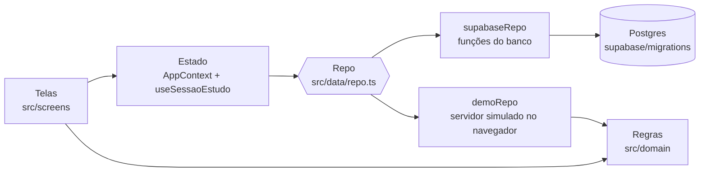
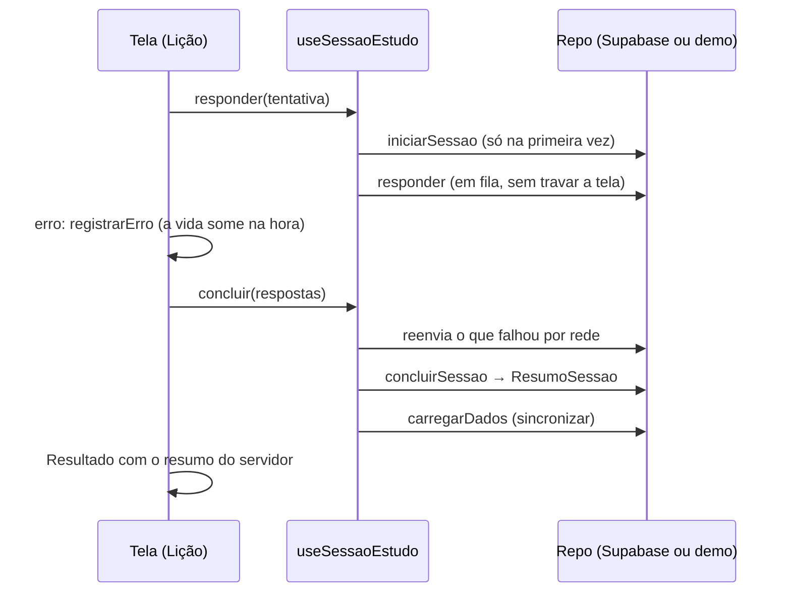

# Arquitetura do Pense

Mapa dos módulos, das interfaces entre eles (os *seams*) e de como as regras do jogo ficam iguais no app e no banco.
Atualizado em 26/10/2026, depois do plano de melhorias (fases F0 a F3).

Vocabulário:

- **módulo profundo:** muito comportamento atrás de uma interface pequena;
- **seam:** o lugar onde a interface mora e onde dá para trocar a implementação;
- **adaptador:** quem implementa o seam (por exemplo, o Supabase ou o modo demonstração).

## Visão geral



O app é uma SPA em React + Vite (HashRouter), publicada no Cloudflare como arquivos estáticos (`wrangler.jsonc`; no GitHub Pages até 25/11/2026). No Supabase, a pontuação é calculada
pelo banco (funções em PL/pgSQL, com RLS); no modo demonstração, o `demoRepo` faz o papel do servidor com as mesmas
regras, escritas em TypeScript.

## Módulos

| Pasta | Módulo | O que faz |
|---|---|---|
| `src/domain` | `regras.ts` | Regras do jogo, funções puras: XP, níveis, vidas e recarga, sequência, domínio e coroas, revisão espaçada (`reagendar`, `revisaoVencida`, `xpDaRevisao`, `vidaPelaRevisao`), temas e unidades da trilha, montagem da lição e do desafio, próximo passo do Início, conquistas. Tudo que depende da hora recebe `agora`. |
| | `sessoes.ts` | O fechamento de uma sessão com as mesmas contas de `concluir_sessao`: `fecharLicao`, `fecharRevisao`, e a reação imediata da tela a cada questão (`registrarErro`, `registrarRevisao`). |
| | `catalogo.ts` | Índice do conteúdo por id (questão, matéria, exame), montado uma vez por carga. |
| `src/data` | `types.ts` | Tipos do conteúdo, do progresso e das sessões (`NovaSessao`, `ResumoSessao`). |
| | `repo.ts` | **Seam `Repo`**: a única interface que as telas usam para dados. Também traduz os erros do Supabase. |
| | `supabaseRepo.ts` | Adaptador do Supabase: Auth, leitura dos dados do aluno e as RPCs `iniciar_sessao`, `responder`, `abrir_dica`, `concluir_sessao`. |
| | `demoRepo.ts` | Adaptador do modo demonstração: guarda tudo no `localStorage` e faz o papel do servidor (confere o gabarito, gasta a vida, fecha a sessão e devolve o resumo), usando `domain/sessoes.ts`. |
| `src/state` | `AppContext.tsx` | Estado global em quatro contextos pequenos: **Conta** (usuário, carregando, erro), **Conteúdo** (questões), **Progresso** (dados do aluno, `atualizar`, `sincronizar`) e **Aviso** (o toast). `useApp()` e `useDados()` juntam os quatro. |
| | `useSessaoEstudo.ts` | Ciclo de vida de uma sessão, com interface pequena: `responder(t)`, `abrirDica(q, n)`, `concluir(respostas)`. Por dentro: abre a sessão no primeiro uso, mantém a fila de chamadas em ordem, reenvia as respostas que falharam por rede e relê os dados no fim. |
| `src/screens` | Telas | Início, Lição, Resultado, Trilha, Revisar, Refazer, Perfil, Configurações, Entrar, Primeiro acesso, Nova senha, Pro. Lição e Refazer carregam sob demanda (`React.lazy`). |
| `src/components` | Peças | Base (barra de navegação, folha, seletor de matérias, anel), questão, texto com fórmulas, sem vidas, anúncio, cartão do Pro, CAPTCHA. |
| `src/styles` | `global.css` | Tokens de cor dos dois temas e as classes das telas (ver [Estilos](#estilos)). |

## Seams

### 1. `Repo` (dados)

As telas nunca falam com o Supabase direto: tudo passa por `repo` (`src/lib/config.ts` escolhe o adaptador pelas
variáveis de ambiente). O contrato importante é o das sessões:

```ts
iniciarSessao(s: NovaSessao): Promise<string>        // abre; lição e desafio levam a lista de questões
responder(sessao: string, t: Tentativa): Promise<void>
abrirDica(sessao: string, questao_id: string, dica: number): Promise<void>
concluirSessao(sessao: string): Promise<ResumoSessao> // sempre devolve o resumo; de novo, o mesmo resumo
salvar(d: DadosAluno, m: Mudancas): Promise<void>    // só nome, preferências e interesse no Pro
```

Os dois adaptadores passam pela **mesma suíte de contrato** (`src/domain/paridade.test.ts`): as mesmas sessões,
com as mesmas expectativas, contra o `demoRepo` (com `localStorage` falso) e contra o `supabaseRepo` de verdade
(com um cliente que fala com um Postgres local, o PGlite). Se uma regra mudar só de um lado, a suíte falha.

### 2. Regras (`src/domain`)

Funções puras. As telas usam as regras para reagir na hora (por exemplo, a vida some assim que o aluno erra); a
palavra final é do servidor, e a tela relê os dados (`sincronizar`) quando a sessão termina.

### 3. Sessão (`useSessaoEstudo`)

Lição e Refazer só chamam `responder`, `abrirDica` e `concluir`. Não calculam o resultado: quem fecha a sessão é o
servidor (ou o `demoRepo`). Sem internet no fim, `concluir` devolve `null` e o Resultado avisa que não salvou.

## Regras em dois lugares

Toda regra de jogo existe no app (`regras.ts` e `sessoes.ts`) **e** no banco (`supabase/migrations`, funções da
`0006`, `0007`, `0009` e `0010`). Para mudar uma regra:

1. escreva o caso em `src/domain/paridade.test.ts` e veja-o falhar nos dois adaptadores;
2. crie uma migration nova (nunca edite uma já aplicada) e some-a ao `supabase/setup_completo.sql`;
3. ajuste `regras.ts` e `sessoes.ts`;
4. rode `npm test`;
5. aplique a migration no SQL Editor do Supabase **antes** de publicar o app.

## Uma lição, por dentro



## Testes

| Arquivo | O que cobre |
|---|---|
| `src/domain/regras.test.ts` | Regras puras com o relógio passado como parâmetro (sem `vi.useFakeTimers`). |
| `src/domain/banco.test.ts` | Funções do banco num Postgres local: o que o app faz e as trapaças das baterias de testes, com os códigos dos relatórios (`N01a`, `RP27`…). Temas, unidades e lições vêm de `regras.ts`. |
| `src/domain/paridade.test.ts` | Suíte de contrato do `Repo` contra os dois adaptadores. |
| `src/domain/testes/banco.ts` | Preparo do PGlite (papéis e `auth.uid()` como no Supabase), aluno de teste, cliente Supabase falso e `passarDias` (o tempo passa recuando as datas guardadas). |

```bash
npm install --no-save @electric-sql/pglite@0.2.17   # uma vez (o CI também instala)
npm run typecheck && npm test
```

O CI (`.github/workflows/testes.yml`) roda o typecheck e os testes a cada push.

## Bateria de QA (`scripts/qa`)

Roda o app em **modo demonstração** (sem tocar no Supabase de produção) e percorre a jornada de um aluno novo com o
[agent-browser](https://agent-browser.dev):

```bash
bash scripts/qa/subir_demo.sh . 5173                          # build de demonstração servido em segundo plano
bash scripts/qa/jornada.sh http://127.0.0.1:5173/ qa-saida    # 19 capturas, axe, console e rede
node scripts/qa/montagem.mjs qa-saida --antes qa-saida-antes  # folha antes × depois, com % de pixels diferentes
```

| Arquivo | Papel |
|---|---|
| `subir_demo.sh` | Build de demonstração (com CSP e service worker) e servidor local; recusa o build se achar o endereço de um projeto Supabase. |
| `jornada.sh` | A jornada: entrada, lição com erro, resultado, trilha, revisão com dica, perfil, configurações, modo noturno, sem vidas e 320 px. |
| `responder.js` | Roda na página: escolhe a alternativa certa ou uma errada pela questão na tela (`data-questao`) e o gabarito do próprio conteúdo. |
| `axe-run.js` | Junta a auditoria do axe (embutido no agent-browser) de cada tela em `axe.json`. |
| `montagem.mjs` | Folha com as capturas; com `--antes`, compara pixel a pixel no Chrome (sem Python nem bibliotecas de imagem). |

A jornada fixa `Math.random` e desliga as animações: duas rodadas seguidas dão as mesmas capturas (só o tempo da
lição no Resultado muda), o que permite refatorar estilos conferindo que nada mudou na tela.

## Estilos

- **Tokens** no `:root` e em `:root[data-theme='dark']`: o teal dos botões (`--primary`, `#237A70`, 5,1:1 com texto
  branco) é o mesmo nos dois temas; texto colorido usa os tokens `-ink` (`--primary-ink`, `--lav-ink`,
  `--amber-ink`, `--ouro/prata/bronze-ink`), que clareiam no escuro. Contraste AA (4,5:1) nos dois temas.
- **Cores das matérias** em `--rc-<cor>-forte` (texto), `-suave` (fundo claro), `-fundo` (sólido sob texto branco)
  e `-barra` (progresso); `CORES_RECORTE` (`components/Base.tsx`) aponta para essas variáveis.
- **Classes das telas** no fim do `global.css` (cabeçalhos, cartões, dicas, trilha, perfil…) e utilitários pequenos
  (`gap-*`, `fs-*`, `entre`, `centro`). `style={{…}}` fica só para o que é dinâmico (largura de barra, cor da
  matéria, atraso de animação): hoje são 33 no `src/`.

## Desempenho

O texto das questões (Markdown, KaTeX e DOMPurify) só carrega com a Lição e o Refazer (`React.lazy`): o JS inicial
fica em cerca de 143 kB gzip, e o do texto (cerca de 98 kB) vem quando o aluno abre uma questão.

## Propostas para depois

- **Conclusão pendente:** quando `concluir_sessao` falha por rede, guardar o id da sessão e tentar de novo na próxima
  abertura do app (a função é idempotente).
- **Temas com ordem fixa:** hoje a ordem dos temas (e as unidades da trilha) depende da quantidade de questões; uma
  tabela de temas com ordem fixa evita reordenar a trilha quando entram questões novas.
- **Modo demonstração e sessões abandonadas:** o `demoRepo` marca as questões acertadas só ao concluir; o banco conta
  também as de sessões não concluídas (diferença pequena, só no XP de questão repetida).
